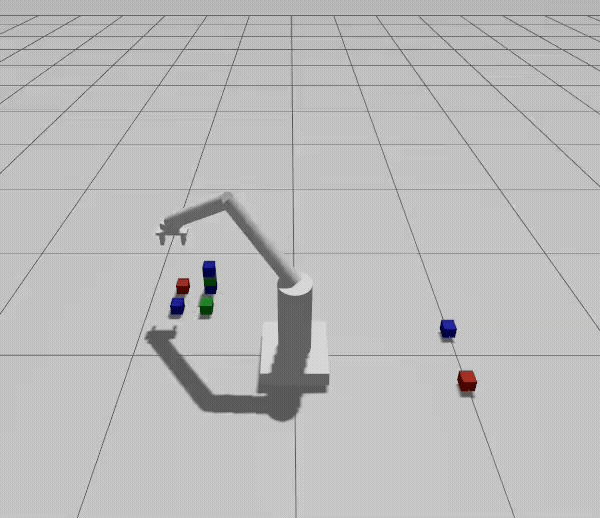

# Vision-Guided Pick & Sort using ROS2

An autonomous robotic pick-and-place system that uses RGB-D vision to detect, localize, and sort cubes by color. Built using ROS2, MoveIt2, OpenCV, and Gazebo Sim.

---

## Demo

<p align="center">
  
</p>

## Features

- **Color Detection:** Detects colored cubes using OpenCV and HSV color segmentation.
- **3D Object Localization:** Estimates cubes positions using RGB-D camera data.
- **Autonomous Manipulation:** Uses MoveIt2 for robotic arm motion planning.
- **Pick and Place:** Performs autonomous object grasping and placement.
- **Color Sorting & Stacking:** Sorts objects into designated locations and stacks cubes of the same color.

## System Architecture

The system consists of two main stages:

### 1. Vision and Perception

- Processing of RGB images from the simulated camera.
- Segmenting of objects using HSV color ranges.
- Extracting centroids and corresponding depth values of the cubes.
- Converting the image coordinates into 3D positions.
- Publishing the cube positions and color information through a custom ROS2 message.

### 2. Motion Planning and Manipulation

- Receiving cube coordinates and color information.
- MoveIt2 to plan manipulator movements.
- Executing Cartesian motions for pickup and placement.
- Controls the gripper to grasp and release cubes.
- Maintains separate stacking positions for different colors.

## Technologies Used

| Technology | Purpose |
|---|---|
| ROS2 Jazzy | Robot communication and system integration |
| MoveIt2 | Motion planning and manipulation |
| Gazebo Sim | Robot and environment simulation |
| OpenCV | Image processing and color detection |
| C++ | Manipulator control |
| Python | Vision and perception |
| RViz2 | Robot visualization |
| URDF/Xacro | Robot description |

### Build

Clone the repository into your ROS2 workspace:

```bash
mkdir -p ~/<workspace_name>/src
cd ~/<workspace_name>/src
git clone https://github.com/vedar01/vision_guided_pick_sort_ros2.git
```

Build the workspace:

```bash
cd ~/<workspace_name>
rosdep install --from-paths src --ignore-src -r -y
colcon build
source install/setup.bash
```

## Usage

After building the workspace, source the setup file in each terminal:

```bash
source ~/<workspace_name>/install/setup.bash
```

### 1. Launch Simulation

Open the first terminal and launch the robot simulation along with the MoveIt configuration.

```bash
ros2 launch arm_bringup pnp_test.launch.xml
```

### 2. Enable Simulation Time

Open a second terminal and enable simulation time for MoveIt.

```bash
ros2 param set /move_group use_sim_time true
```

### 3. Run Pick-and-Place

Open a third terminal and start the autonomous pick-and-place system.

```bash
ros2 run arm_system_tests pickup_n_sort
```

### Expected Result

The robot detects cubes using RGB-D camera, estimates their 3D positions, picks them up, and sorts and stacks them according to their colors.

## Future Improvements

- Improve object localization accuracy.
- Implement more robust grasp detection.
- Support objects with different shapes and orientations.
- Integrate more advanced collision-aware manipulation.

## Author

**Vedant Dahake**

[GitHub](https://github.com/vedar01)
